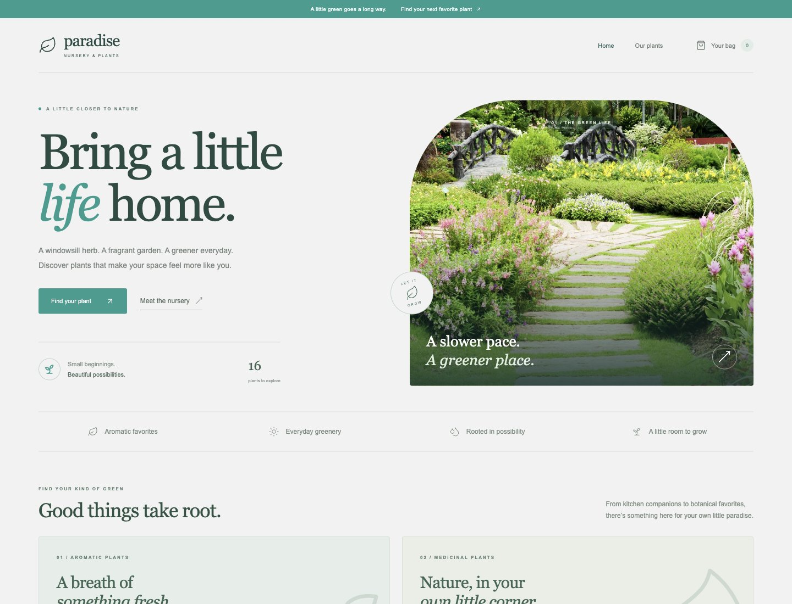

# Paradise Nursery

A plant-shop portfolio demo built with React, Redux Toolkit, React Router, and Vite. The redesign keeps the original teal (`#2a9d8f`) identity and garden photograph, with an editorial landing page and a consistent catalog and shopping bag.

[Live demo](https://franxis12.github.io/learning_react/)



## Features

- Responsive landing page with links to aromatic and medicinal collections.
- Sixteen plants with category filters and clear add-to-bag feedback.
- Quantity controls, removal, accurate subtotals, and persistent cart state.
- Graceful fallback when an original remote product photograph is unavailable.
- Keyboard labels, visible focus styles, and reduced-motion support.

This is a demonstration, not an operating store. Prices are examples. The bag review does not place orders or process payments. The original product image sources remain in `src/data/productsData.js`; the garden photograph is bundled locally.

## Development

```sh
npm ci
npm run dev
npm run build
npm run lint
```

Vite uses `/learning_react/` as its base path. Hash routing supports direct navigation on GitHub Pages. `npm run deploy` builds and updates the existing `gh-pages` publication branch. Development changes belong on `main`.

## Validation

Production build and ESLint pass. Browser checks cover collection navigation, adding/removing plants, quantity totals, persisted cart state, demo review, and mobile layouts.
